  

<h1 align="center">Awesome Online Discussion Forum & Knowledge Sharing 💬✨</h1>

  
  
  
  
  
  
  

> 🌟 **A curated list of top Online Discussion Forum and Knowledge Sharing platforms** — featuring both enterprise SaaS/Hosted commercial solutions and top open-source self-hosted alternatives for building developer communities, Q&A help centers, and social knowledge bases.
> 
> 🚀 Star this repo if you find it helpful for your community architecture! 🌟

---

## 📋 Table of Contents

- [🌐 Sector Overview & Market Dynamics](#-sector-overview--market-dynamics)
- [🟦 SaaS / Hosted Platforms](#-saas--hosted-platforms)
- [🟩 Open-Source Software](#-open-source-software)
  - [Discourse](#1-discourse-)
  - [Forem](#2-forem-)
  - [Flarum](#3-flarum-)
  - [Apache Answer](#4-apache-answer-)
  - [NodeBB](#5-nodebb-)
  - [Lemmy](#6-lemmy-)
  - [HumHub](#7-humhub-)
  - [bbs-go](#8-bbs-go-)
  - [FlaskBB](#9-flaskbb-)
  - [phpBB](#10-phpbb-)
  - [MyBB](#11-mybb-)
  - [Simple Machines Forum (SMF)](#12-simple-machines-forum-smf-)
- [📊 Comparison at a Glance](#-comparison-at-a-glance)
- [🤝 Contributing](#-contributing)
- [💖 Support](#-support)
- [📈 Star History](#-star-history)
- [📄 License](#-license)

---

## 🌐 Sector Overview & Market Dynamics

The global online community and discussion forum software market is currently valued between **$2.5B–$4.5B** and projected to expand beyond **$8B–$10B+** over the next decade at a compound annual growth rate (CAGR) of 12%–13.5%. 

The market exhibits **moderate fragmentation**:
- **Enterprise CRM & CX Suites:** Large enterprise giants (e.g., Khoros, Salesforce Experience Cloud) command high-value annual contracts for Fortune 500 brand communities and support centers.
- **Mid-Market & Creator Platforms:** Specialized SaaS providers (e.g., Bettermode, Vanilla Forums) deliver turnkey modern community and Q&A tools with headless APIs and CRM integrations.
- **Vibrant Open-Source Long-Tail:** Modern self-hosted engines (e.g., Discourse, Apache Answer, Flarum, NodeBB) and decentralized federated platforms (e.g., Lemmy) power millions of active independent communities, ensuring extensive developer flexibility without vendor lock-in.

---

## 🟦 SaaS / Hosted Platforms

Commercial, cloud-hosted Online Discussion Forum and Knowledge Sharing platforms. Sorted descending by company scale (revenue / valuation):

| 🏢 Product | 💰 Company Valuation / Revenue | 🏷️ Starting Pricing | 🎁 Free Tier / Trial Limit | ⚡ Key Focus & Highlights |
|:---|:---|:---|:---|:---|
| **Zoho Discussions (Zoho Community / Connect)** | **$12.5B valuation** (est.) / **~$1.5B annual revenue** (FY25, ₹12,313 Cr) | **$14/agent/month** (Zoho Desk Standard, billed annually, unlocks community forums) / **$1/user/month** (Zoho Connect internal) | **Free tier available forever**: Free for up to 5 users, 3 groups, and 3 custom apps/boards (Zoho Connect) / 3 agents (Zoho Desk, basic) | Part of the Zoho ecosystem; rich text editor, SEO, SSO integration, spam filtering, and migration from vBulletin/phpBB. |
| **Khoros Communities** | **$1B–$1.5B valuation** (Vista Equity buyout) / **~$250M–$285M annual revenue** | **$4,166/month** (contracts typically start at **$50,000/year**) | **No free tier; no public free trial** (Evaluation strictly via scheduled enterprise sales demo) | Enterprise-grade digital customer community, social media management, and care platform for Fortune 500 brands. |
| **Vanilla Forums (Higher Logic Vanilla)** | **$185M+ total capital raised** / **~$80M+ recurring revenue** (Higher Logic parent) | **$599/month** (Standard package; annualized contracts start at **$24,000/year**) | **No free tier; no self-serve free trial** (Available through scheduled sales demo and trial upon approval) | Enterprise customer community and knowledge base software with Q&A, gamification, and deep CRM/SSO integrations. |
| **Bettermode** | **$7.5M Seed funding** (backed by Bessemer & CRV) / **~$3.1M ARR** | **$149/month** (Starter tier billed annually, up to 10,000 members) | **14-day free trial** with full Starter/Growth features (no credit card required); no forever-free tier | Modern community platform featuring discussion forums, Q&A, AI spam filtering, federated search, and modular integrations. |

---

## 🟩 Open-Source Software

Self-hosted, community-driven Online Discussion Forum and Knowledge Sharing tools. Ranked in **descending order by GitHub stargazers count** ⭐:

### 1. Discourse 💬

- **Repository:** [discourse/discourse](https://github.com/discourse/discourse)
- **Stack:** Ruby on Rails / PostgreSQL / Redis / Ember.js | **License:** GPL-2.0-or-later
- **Overview:** Discourse is the gold standard for modern open-source community discussion platforms. Designed for durable, searchable, high-signal conversations with infinite scrolling, real-time notifications, dynamic trust levels, rich markdown/WYSIWYG editing, OAuth2/custom SSO, and comprehensive APIs.
- **Best for:** Professional communities, developer ecosystems, and enterprises seeking a battle-tested, highly extensible discussion platform.

### 2. Forem 🌐

- **Repository:** [forem/forem](https://github.com/forem/forem)
- **Stack:** Ruby on Rails / PostgreSQL / Redis / Preact | **License:** AGPL-3.0
- **Overview:** The open-source software powering DEV.to and numerous global developer networks. Combines threaded discussion forums with rich article publishing, member feeds, podcasts, listings, and social community features in one unified hub.
- **Best for:** Content-driven developer communities, collaborative blogging networks, and social knowledge hubs.

### 3. Flarum ⚡

- **Repository:** [flarum/flarum](https://github.com/flarum/flarum)
- **Stack:** PHP / MySQL / Mithril.js | **License:** MIT
- **Overview:** Flarum is a lightweight, mobile-first discussion platform with a modern, elegant two-pane interface. It features instant search, smooth infinite scrolling, floating composer windows, and an extensive modular extension architecture.
- **Best for:** Small to mid-sized communities wanting a fast, aesthetically pleasing forum with minimal server overhead.

### 4. Apache Answer 💡

- **Repository:** [apache/answer](https://github.com/apache/answer)
- **Stack:** Go / React / Docker | **License:** Apache-2.0
- **Overview:** An official Apache Software Foundation top-level project designed specifically for Q&A community platforms, help desks, and team knowledge bases. It features upvoting, reputation mechanics, badge gamification, tag categorization, and rapid one-command Docker deployments.
- **Best for:** Teams and developer portals needing a lightweight, Apache-licensed Stack Overflow alternative for knowledge management.

### 5. NodeBB 🚀

- **Repository:** [NodeBB/NodeBB](https://github.com/NodeBB/NodeBB)
- **Stack:** Node.js / Redis / MongoDB / Socket.io | **License:** GPL-3.0
- **Overview:** NodeBB leverages WebSockets for real-time interactions, offering streaming discussions, instant live notifications, built-in chat, social sharing, and an active ecosystem of themes and plugins.
- **Best for:** Node.js-centric teams seeking a reactive, real-time community forum with seamless API integration.

### 6. Lemmy 🪐

- **Repository:** [LemmyNet/lemmy](https://github.com/LemmyNet/lemmy)
- **Stack:** Rust / Actix / PostgreSQL / WebAssembly | **License:** AGPL-3.0
- **Overview:** A federated, link-aggregating discussion platform for the ActivityPub fediverse (a decentralized alternative to Reddit). Supports nested comments, voting, community moderation tools, and cross-server federation.
- **Best for:** Decentralized, privacy-conscious communities and open-web link aggregator forums.

### 7. HumHub 👥

- **Repository:** [humhub/humhub](https://github.com/humhub/humhub)
- **Stack:** PHP (Yii 2) / MySQL / MariaDB | **License:** AGPL-3.0
- **Overview:** A flexible social network and community kit providing discussion streams, user spaces, knowledge wikis, file sharing, calendar scheduling, and an internal module marketplace.
- **Best for:** Organizations, intranets, non-profits, and educational institutes seeking a social collaboration network.

### 8. bbs-go 📱

- **Repository:** [mlogclub/bbs-go](https://github.com/mlogclub/bbs-go)
- **Stack:** Go / Vue.js / Nuxt.js / MySQL | **License:** Apache-2.0
- **Overview:** A modern, high-performance community forum and Q&A system built with Go and Vue/Nuxt. Includes responsive mobile web views, full markdown support, tag management, and fast indexing.
- **Best for:** High-concurrency community sites and developer groups wanting a Go-backed discussion backend.

### 9. FlaskBB 🐍

- **Repository:** [flaskbb/flaskbb](https://github.com/flaskbb/flaskbb)
- **Stack:** Python / Flask / SQLAlchemy / PostgreSQL / MySQL | **License:** BSD-3-Clause
- **Overview:** A classic bulletin board application built on Python's Flask framework. Offers traditional forum hierarchies, private messaging, user permissions, customizable themes, and a clean plugin architecture.
- **Best for:** Python developers and hobbyist communities desiring a clean, modular Python-powered bulletin board.

### 10. phpBB 📜

- **Repository:** [phpbb/phpbb](https://github.com/phpbb/phpbb)
- **Stack:** PHP / MySQL / MariaDB / PostgreSQL / SQLite | **License:** GPL-2.0
- **Overview:** The most battle-tested open-source bulletin board package on the web. Features extensive permission hierarchies, private messaging, customizable styles, LDAP/OAuth SSO authentication, and thousands of community mods.
- **Best for:** Communities requiring an established, proven forum engine with lightweight shared-hosting requirements.

### 11. MyBB 🛠️

- **Repository:** [mybb/mybb](https://github.com/mybb/mybb)
- **Stack:** PHP / MySQL / PostgreSQL / SQLite | **License:** LGPL-3.0
- **Overview:** A popular, user-friendly bulletin board engine featuring threaded and flat discussions, inline moderation, custom profile fields, reputation systems, and an accessible template engine.
- **Best for:** Traditional webmasters seeking an easy-to-manage, customizable community forum.

### 12. Simple Machines Forum (SMF) ⚙️

- **Repository:** [SimpleMachines/SMF](https://github.com/SimpleMachines/SMF)
- **Stack:** PHP / MySQL / PostgreSQL | **License:** BSD-3-Clause
- **Overview:** A professional-grade, permissive open-source forum package engineered for high performance, low database footprint, and complete administrative control.
- **Best for:** Forum administrators who prefer a permissive BSD license, high stability, and low resource overhead.

---

## 📊 Comparison at a Glance

| 🛠️ Software | 📜 License | 💻 Stack | 💡 Q&A Focus | 🔐 SSO Support | 🏠 Self-Hosted | 🎯 Best For |
|:---|:---|:---|:---:|:---:|:---:|:---|
| **Discourse** | GPL-2.0 | Ruby / PostgreSQL / Redis | ✅ | ✅ OAuth2 / SAML | ✅ | Scaled modern communities & brands |
| **Forem** | AGPL-3.0 | Ruby / PostgreSQL / Preact | ✅ | ✅ OAuth | ✅ | Content publishing + dev communities |
| **Flarum** | MIT | PHP / MySQL | (Forum) | (Extensions) | ✅ | Lightweight, modern minimalist forums |
| **Apache Answer** | Apache-2.0 | Go / React / Docker | ✅ Primary | ✅ OAuth / Plugins | ✅ | Knowledge bases & Q&A help desks |
| **NodeBB** | GPL-3.0 | Node.js / Redis / Mongo | (Forum) | ✅ OAuth / Plugins | ✅ | Real-time reactive WebSockets forums |
| **Lemmy** | AGPL-3.0 | Rust / PostgreSQL | (Federated) | (ActivityPub) | ✅ | Federated link-aggregation & discussions |
| **HumHub** | AGPL-3.0 | PHP / MySQL | ✅ | ✅ LDAP / SAML | ✅ | Social intranet & team collaboration |
| **bbs-go** | Apache-2.0 | Go / Vue.js | ✅ | (OAuth) | ✅ | High-performance Go-backed forums |
| **FlaskBB** | BSD-3-Clause | Python / Flask | (Forum) | (Plugins) | ✅ | Python community bulletin boards |
| **phpBB** | GPL-2.0 | PHP / MySQL / SQLite | (Forum) | ✅ LDAP / OAuth | ✅ | Proven classic forums on shared hosting |
| **MyBB** | LGPL-3.0 | PHP / MySQL | (Forum) | ✅ | ✅ | Traditional bulletin boards with easy setup |
| **SMF** | BSD-3-Clause | PHP / MySQL | (Forum) | ✅ | ✅ | Permissive BSD-licensed lightweight forums |
| **Zoho Discussions** | Proprietary | Cloud SaaS | (Forum) | ✅ | ❌ | Teams embedded in Zoho ecosystem |
| **Bettermode** | Proprietary | Cloud SaaS | ✅ | ✅ | ❌ | Turnkey modern community + AI features |
| **Vanilla Forums** | Proprietary | Cloud SaaS | ✅ | ✅ | ❌ | Enterprise corporate communities |
| **Khoros** | Proprietary | Cloud SaaS | ✅ | ✅ | ❌ | Global Fortune 500 CX & customer support |

---

## 🤝 Contributing

Contributions are warmly welcomed! If you know of an outstanding open-source Online Discussion Forum, Q&A, or Knowledge Sharing tool that should be listed here:

1. 🍴 Fork this repository.
2. 🌿 Create a new feature branch (`git checkout -b feature/add-new-platform`).
3. 📝 Add your project with description, GitHub stars badge, stack, license, and primary use case.
4. 🚀 Submit a well-described Pull Request!

Please ensure the project is actively maintained and genuinely open-source.

---

## 💖 Support

If this curated repository helped you discover the right discussion forum or knowledge sharing solution for your project, please consider showing your support:

- ⭐ **Star this repository** to help others discover it!
- 🍴 **Fork and share** it with fellow developers and community builders.
- ☕ **Buy me a coffee / Sponsor the project:** Support ongoing open-source curation on the [GitHub Sponsor Dashboard](https://github.com/sponsors/ishandutta2007).

---

## 📈 Star History

---

## 📄 License

This compilation is released under [CC0 1.0 Universal (Public Domain Dedication)](https://creativecommons.org/publicdomain/zero/1.0/). The individual software projects listed retain their respective licenses and trademarks.

---

  <b>⭐ Star this repo if you found it useful! ⭐</b>

